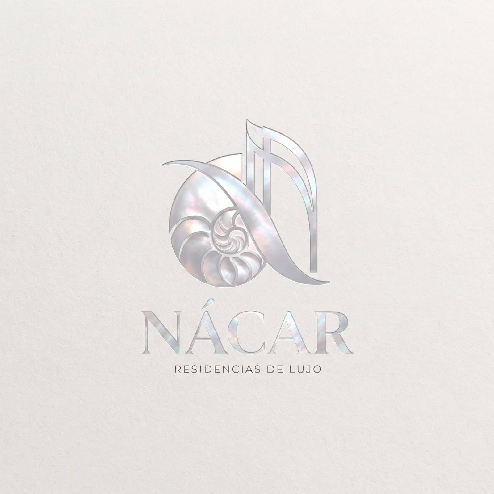
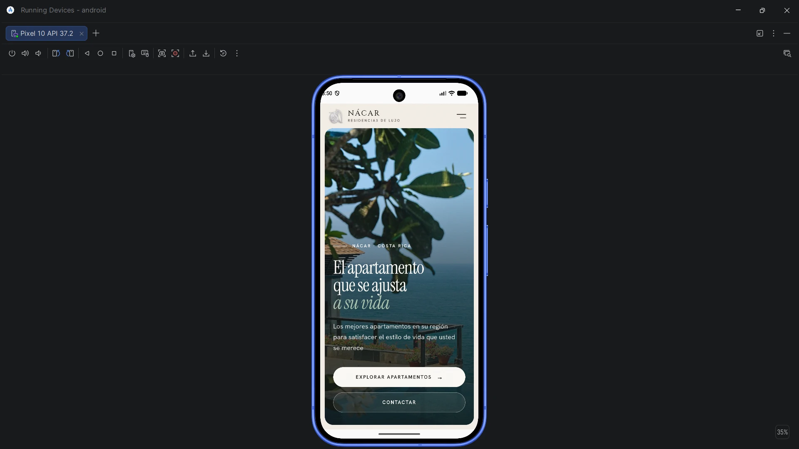

<p align="center">
  
</p>

# Nácar · Residencias de lujo

Aplicación web y móvil para promocionar apartamentos de lujo en Costa Rica. El visitante puede recorrer el catálogo, filtrar propiedades, ver el detalle de cada apartamento, guardar favoritos y solicitar información o una visita. La misma base de código genera la versión web (publicada en Vercel) y la versión Android (empaquetada con Capacitor).

Proyecto #1 · IF0009 Desarrollo de Software IV · Universidad de Costa Rica, Sede de Occidente · II Semestre 2026.

## Enlaces

| Recurso | Enlace |
| --- | --- |
| Versión publicada (Vercel) | **PENDIENTE: pegar la URL de Vercel** |
| Repositorio | https://github.com/diego0226/proyectoDevIV |
| Evidencia Android | [Captura en el emulador](#evidencia-en-android) |

## Equipo

| Integrante | Aporte principal |
| --- | --- |
| Diego | Catálogo: datos JSON, tarjetas, lista, filtros, paginación, página Apartamentos y footer |
| Rafael | Inicio, detalle del apartamento, sistema de diseño, rediseño y logo |
| Jered | Favoritos (Context API + localStorage), página de Contacto con su formulario y NotFound |

## Tecnologías

- **React 19** con **TypeScript**, creado con **Vite** (plantilla `react-ts`)
- **React Router DOM 7** para la navegación sin recargar la página
- **React Hook Form** para el manejo y la validación del formulario de contacto
- **CSS propio** (variables CSS, sin Tailwind, Bootstrap ni plantillas)
- **Capacitor** para generar la aplicación Android
- **Vercel** para la publicación web
- **ESLint** para la revisión del código
- Google Fonts: Instrument Serif, Cinzel y Hanken Grotesk

## Funcionalidades

| Página | Ruta | Contenido |
| --- | --- | --- |
| Inicio | `/` | Menú con logo y nombre, presentación de la empresa, propuesta de valor, apartamentos destacados y footer |
| Apartamentos | `/apartamentos` | Catálogo completo con búsqueda, filtros y paginación de 5 apartamentos por página |
| Detalle | `/apartamentos/:id` | Ruta dinámica con toda la información del apartamento, botón de favorito y botón para solicitar visita |
| Favoritos | `/favoritos` | Apartamentos guardados por el usuario |
| Contacto | `/contacto` | Formulario para solicitar información o una visita |
| No encontrada | `*` | Respuesta para cualquier ruta que no existe |

- **Catálogo:** 22 apartamentos en `public/data/apartments.json`, cargados con `fetch` dentro del hook personalizado `useFetch`. Cada uno muestra nombre, ubicación, precio, imagen, descripción, habitaciones, baños, área y amenidades. Se muestran estados de carga, error y "sin resultados".
- **Filtros:** búsqueda por texto (nombre, ubicación y amenidades, sin importar tildes ni mayúsculas), ubicación, cantidad mínima de habitaciones y precio máximo. Los resultados se calculan con `filter()` dentro de `useMemo`, por lo que el arreglo original nunca se modifica. Al cambiar un filtro se vuelve a la página 1.
- **Menú:** visible en todas las páginas, con la sección activa resaltada (`NavLink`). En pantallas pequeñas se abre y cierra con un botón y se cierra solo al elegir una opción.
- **Favoritos:** se agregan y eliminan desde la tarjeta o el detalle. Se comparten en toda la app con Context API (`FavoritesProvider` + `useFavorites`) y se guardan en `localStorage`, así que siguen ahí al recargar.
- **Formulario:** nombre, correo, teléfono (opcional), apartamento de interés y mensaje. Valida campos obligatorios, formato de correo y un mínimo de 20 caracteres en el mensaje, y muestra cada error junto a su campo. Al abrirlo desde el detalle (`/contacto?propiedad=<id>`) el apartamento ya viene seleccionado.

> **Envío simulado:** el proyecto no tiene backend. Al enviar el formulario se muestra una confirmación, pero los datos no se mandan a ningún servidor. La propia confirmación lo indica.

## Instalación

Requisitos: [Node.js](https://nodejs.org/) 20.19 o superior (o 22.12+) y npm. Para Android: Android Studio con un emulador o un dispositivo físico.

```bash
git clone https://github.com/diego0226/proyectoDevIV.git
cd proyectoDevIV/nacar
npm install
npm run dev
```

La aplicación queda disponible en http://localhost:5173.

## Comandos

Todos se ejecutan dentro de la carpeta `nacar/`.

| Comando | Descripción |
| --- | --- |
| `npm install` | Instala las dependencias |
| `npm run dev` | Inicia el servidor de desarrollo |
| `npm run build` | Revisa los tipos con TypeScript y genera la versión de producción en `dist/` |
| `npm run preview` | Sirve localmente la versión compilada de `dist/` |
| `npm run lint` | Revisa el código con ESLint |
| `npx cap sync android` | Copia `dist/` al proyecto Android y sincroniza los plugins |
| `npx cap open android` | Abre el proyecto Android en Android Studio |

## Android con Capacitor

Configuración en `nacar/capacitor.config.ts`:

- `appId`: `com.nacar.app`
- `appName`: `Nácar`
- `webDir`: `dist`

Pasos para generar y ejecutar la app:

```bash
npm run build
npx cap sync android
npx cap open android
```

En Android Studio se elige el emulador o el dispositivo y se presiona **Run**. Para generar un APK de prueba: **Build → Build App Bundle(s) / APK(s) → Build APK(s)**.

### Evidencia en Android

La aplicación ejecutándose en el emulador de Android Studio (Pixel 10, API 37.2):

<p align="center">
  
</p>

## Publicación en Vercel

El proyecto se publica desde este repositorio con la configuración:

- **Root Directory:** `nacar`
- **Framework Preset:** Vite
- **Build Command:** `npm run build`
- **Output Directory:** `dist`

Como es una SPA, `nacar/vercel.json` redirige todas las rutas a `index.html`. Así React Router responde rutas como `/apartamentos/3` o `/favoritos` aunque se recargue el navegador.

## Estructura del proyecto

```
nacar/
├── public/
│   ├── data/apartments.json        # Datos del catálogo (22 apartamentos)
│   └── images/                     # Fotos de los apartamentos y logo
└── src/
    ├── main.tsx                    # BrowserRouter + FavoritesProvider
    ├── index.css                   # Sistema de diseño: variables, tipografía, botones
    ├── app/App.tsx                 # Definición de rutas
    └── features/
        ├── home/                   # Inicio: Hero, ValueProposition, FeaturedApartments, About
        ├── apartments/             # Catálogo, detalle, tarjetas, FilterBar y tipos
        ├── favorites/              # Context, provider, hook useFavorites, botón y página
        ├── contact/                # Formulario, información de contacto y tipos
        └── shared/                 # Layout (NavBar, Footer), Pagination, NotFound,
                                    # hook useFetch y utilidades
```

El código se organiza por funcionalidad (`features/`): cada carpeta agrupa sus páginas, componentes, tipos y estilos. Cada componente tiene su propio archivo `.css`.

## Decisiones técnicas

- **TypeScript:** interfaces para `Apartment`, `ApartmentFilters`, `ContactFormData`, `FavoritesContextType` y las props de cada componente. No se usa `any`.
- **Hooks:**
  - `useState`: filtros, página actual, menú móvil, favoritos y estado del envío.
  - `useEffect`: `fetch` de los datos, guardar favoritos en `localStorage`, prellenar el formulario y mover el foco a la confirmación.
  - `useMemo`: lista de ubicaciones y resultados filtrados.
  - `useRef`: foco en el mensaje de confirmación.
  - `useContext`: favoritos compartidos.
  - `useParams` / `useSearchParams`: id del detalle y apartamento preseleccionado en el formulario.
  - Hooks propios: `useFetch<T>` (genérico, devuelve `data`, `isLoading` y `error`) y `useFavorites`.
- **Favoritos:** el estado inicial se lee de `localStorage` una sola vez (inicialización perezosa de `useState`) y se valida que sea un arreglo de números; si los datos están dañados se empieza con una lista vacía.
- **Accesibilidad básica:** `lang="es"`, textos alternativos en imágenes, `aria-label` y `aria-expanded` en el menú, `aria-invalid` en campos con error, `role="status"` / `role="alert"` en mensajes y soporte para `prefers-reduced-motion`.

## Identidad visual

- **Nombre:** *Nácar*, la capa perlada del interior de las conchas: algo valioso, natural y costero, como los apartamentos del catálogo.
- **Logo:** emblema propio inspirado en una concha, usado en el menú, el footer y como ícono de la app.
- **Paleta:** perla (`#f3eee6`) y concha (`#fbf9f5`) como fondos claros, tinta (`#181714`) para el texto y verde musgo (`#2f4a3b`) como color principal. El único degradado es un brillo nacarado que recuerda al material.
- **Tipografía:** Instrument Serif para títulos con tono editorial, Cinzel para la marca y Hanken Grotesk para el texto y la interfaz.
- **Responsivo:** diseñado para teléfono, tableta y computadora con media queries y tamaños fluidos (`clamp()`).

## Flujo de trabajo con Git

- `main`: proyecto base de React.
- `develop`: rama de integración. Todo llega por pull request.
- `feature-estructura`: estructura base del proyecto, de donde salió el trabajo de cada integrante.
- `feature-<funcionalidad>-<integrante>`: una rama por funcionalidad (por ejemplo `feature-filterBar-Diego`, `feature-Favorites-Jered`, `feature-resiseño-Rafael`), integrada a `develop` mediante pull request.
